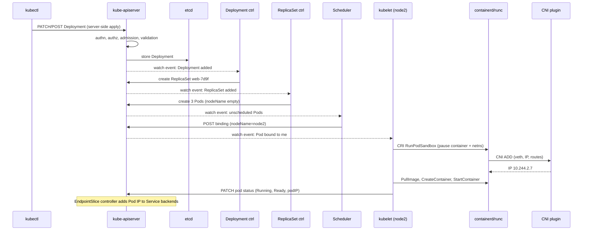

# 02 — Kubernetes Architecture Deep Dive

```text
┌──────────────────────────────── CONTROL PLANE ─────────────────────────────────┐
│                                                                                │
│   ┌──────────────┐  watch/bind   ┌──────────────────────────────────────────┐  │
│   │kube-scheduler│◄─────────────►│                                          │  │
│   └──────────────┘               │            kube-apiserver :6443          │  │
│   ┌──────────────────────┐       │  authn → authz → admission → validation  │  │
│   │kube-controller-mgr   │◄─────►│        → persist → notify watchers       │  │
│   │ (Deployment, RS, Node│       │                                          │  │
│   │  Job, EndpointSlice…)│       └───────────────┬──────────────────────────┘  │
│   └──────────────────────┘                       │ gRPC (mTLS) :2379           │
│   ┌──────────────────────┐                ┌──────▼──────┐                      │
│   │cloud-controller-mgr  │◄──────────────►│    etcd     │ (Raft, 3 or 5 nodes) │
│   └──────────────────────┘                └─────────────┘                      │
└──────────────────────────────────────▲─────────────────────────────────────────┘
                                       │ HTTPS: kubelet & kube-proxy WATCH the API
                ┌──────────────────────┴───────────────────────┐
┌───────────────▼──────────── WORKER NODE ─────────────────────▼─────────────────┐
│  kubelet :10250 ──CRI gRPC──► containerd ──► shim ──► runc ──► containers      │
│     │  └─ calls CNI plugin (via runtime) to set up Pod network                 │
│     └─ reports node status, Lease heartbeat, Pod status                        │
│  kube-proxy  → programs iptables/nftables/IPVS for Services                    │
└────────────────────────────────────────────────────────────────────────────────┘
```

**Golden rule:** *only the API server talks to etcd.* Every other component talks to the API server,
and almost all of them use the **watch** pattern rather than polling.

---

## 1. Control plane components

### 1.1 kube-apiserver

The front door and the only component with direct etcd access.

Request pipeline:

```text
request ─► TLS ─► Authentication ─► Authorization ─► Mutating admission ─► Schema validation
        (x509 certs,        (RBAC, Node,       (defaults, sidecar     ─► Validating admission
         tokens, OIDC)       Webhook)           injection, webhooks)      (PSA, ValidatingAdmissionPolicy, webhooks)
                                                                       ─► write to etcd ─► notify watchers
```

- Stateless → scale horizontally behind a load balancer.
- Serves **watch** streams: clients say "send me changes after resourceVersion X".
- Provides **API Priority and Fairness** so one noisy client can't starve others.
- Port **6443** by default.

### 1.2 etcd

A distributed, strongly-consistent key-value store using the **Raft** consensus algorithm.

- Stores every object under keys like `/registry/pods/default/web-abc`.
- Needs a **quorum** (majority): 3 members tolerate 1 failure, 5 tolerate 2. Even numbers add no safety.
- Sensitive to disk latency (fsync) → use SSDs; watch `etcd_disk_wal_fsync_duration_seconds`.
- Ports: **2379** client, **2380** peer.
- **Back it up**: `etcdctl snapshot save`. Losing etcd = losing the cluster's state.

```bash
# On a kubeadm control-plane node (sudo: certs are root-only)
sudo ETCDCTL_API=3 etcdctl \
  --endpoints=https://127.0.0.1:2379 \
  --cacert=/etc/kubernetes/pki/etcd/ca.crt \
  --cert=/etc/kubernetes/pki/etcd/server.crt \
  --key=/etc/kubernetes/pki/etcd/server.key \
  snapshot save /var/backups/etcd-$(date +%F).db
sudo etcdutl snapshot status /var/backups/etcd-$(date +%F).db -w table   # etcdutl handles offline snapshot ops
```

### 1.3 kube-scheduler

Watches for Pods with empty `spec.nodeName` and picks a node.

```text
 unscheduled Pod
      │
      ▼
 ┌─ Filtering (Filter plugins) ──────────────┐  e.g. NodeResourcesFit, NodeAffinity,
 │ remove nodes that cannot run the Pod      │  TaintToleration, VolumeBinding, PodTopologySpread
 └───────────────┬───────────────────────────┘
                 ▼
 ┌─ Scoring (Score plugins) ─────────────────┐  e.g. LeastAllocated/MostAllocated,
 │ rank remaining nodes 0–100                │  InterPodAffinity, ImageLocality
 └───────────────┬───────────────────────────┘
                 ▼
 Reserve → Permit → PreBind → Bind (writes pods/<name>/binding → sets spec.nodeName)
```

If no node passes filtering → Pod stays `Pending` with event `FailedScheduling`, and the
**preemption** logic may evict lower-priority Pods. Details in [chapter 08](../08-scheduling/README.md).

### 1.4 kube-controller-manager

One binary running many controllers, each a reconciliation loop:

| Controller | Reconciles |
|------------|-----------|
| Deployment | Deployments → ReplicaSets (rollouts) |
| ReplicaSet | ReplicaSets → Pods (count) |
| StatefulSet, DaemonSet, Job, CronJob | their workloads |
| Node lifecycle | marks nodes `Unknown`, adds `NoExecute` taints, triggers eviction |
| EndpointSlice | Services + ready Pods → EndpointSlices |
| ServiceAccount / token | default SAs, tokens |
| Namespace | deletes contents of terminating namespaces |
| Garbage collector | deletes dependents via ownerReferences |
| PV binder / attach-detach | storage binding |

Only one instance is active at a time (**leader election** via a `Lease` in `kube-system`).

### 1.5 cloud-controller-manager (CCM)

Contains cloud-specific loops so core Kubernetes stays cloud-neutral:

- **Node controller**: labels nodes with zone/instance type, deletes Node objects whose VM is gone.
- **Route controller**: programs cloud routes for Pod CIDRs (some setups).
- **Service controller**: creates cloud load balancers for `type: LoadBalancer`.

On EKS, much LB work is done by the separate **AWS Load Balancer Controller** add-on.

---

## 2. Worker node components

### 2.1 kubelet

The node agent (a systemd service, not a Pod).

- Registers the Node, sends status and Lease heartbeats.
- Watches Pods bound to its node and makes them run via **CRI**.
- Runs probes (liveness/readiness/startup), restarts containers per `restartPolicy`.
- Mounts volumes (via CSI), pulls Secrets/ConfigMaps.
- Evicts Pods under resource pressure.
- Runs **static Pods** from `/etc/kubernetes/manifests` (how kubeadm runs the control plane).
- Serves an API on **10250** (logs, exec, metrics) — authenticated.

### 2.2 kube-proxy

Runs on each node (DaemonSet). Watches Services + EndpointSlices and programs the kernel
(iptables/nftables/IPVS) so traffic to a Service virtual IP reaches a backend Pod. It is **not** in
the data path in iptables/nftables mode — the kernel forwards packets. Can be replaced by eBPF
(Cilium). See [05.06](../05-networking/06-kube-proxy/README.md).

### 2.3 Container runtime, CRI, containerd, OCI

| Term | What it is |
|------|------------|
| **CRI** | Container Runtime Interface: gRPC API kubelet uses (`RunPodSandbox`, `CreateContainer`, `StartContainer`, `PullImage`…) |
| **containerd** | CNCF runtime implementing CRI; default on most distros, EKS, GKE, AKS |
| **CRI-O** | Alternative CRI runtime (OpenShift) |
| **OCI** | Open Container Initiative: image format, runtime spec, distribution spec |
| **runc** | Reference OCI runtime that calls the kernel (namespaces, cgroups) |
| ⚠️ dockershim | Removed in v1.24. Docker-built images still run fine (they're OCI images). `cri-dockerd` exists if you truly need Docker Engine as runtime |

---

## 3. What happens after `kubectl apply -f deployment.yaml`



Step by step in English:

1. **kubectl** reads your kubeconfig, sends an HTTPS request (server-side apply or a 3-way merge patch).
2. **API server** authenticates you (cert/token), authorizes (RBAC), runs admission (defaults, policy),
   validates schema, saves to **etcd**, returns success. *Nothing is running yet.*
3. **Deployment controller** sees the new Deployment and creates a **ReplicaSet**.
4. **ReplicaSet controller** sees the ReplicaSet wants 3 Pods and creates 3 **Pod** objects with no node.
5. **Scheduler** filters and scores nodes, writes a **Binding** → `spec.nodeName=node2`.
6. **kubelet on node2** sees a Pod bound to it, asks **containerd** via CRI to create the **Pod sandbox**
   (pause container + network namespace).
7. The runtime invokes the **CNI plugin**, which creates the veth pair, assigns an IP (IPAM) and routes.
8. kubelet pulls the image, runs init containers in order, then starts app containers.
9. kubelet runs probes; when the readiness probe passes, Pod condition `Ready=True`.
10. **EndpointSlice controller** adds the Pod's IP to the Service's EndpointSlice; **kube-proxy** on every
    node updates its rules → the Pod receives traffic.

---

## 4. How Kubernetes monitors and recovers workloads

| Failure | Who notices | Recovery |
|---------|-------------|----------|
| Container process exits | kubelet | restart per `restartPolicy` with exponential back-off (CrashLoopBackOff up to 5 min) |
| Liveness probe fails | kubelet | kill & restart the container |
| Readiness probe fails | kubelet → EndpointSlice ctrl | Pod removed from Service backends (not restarted) |
| Pod deleted/evicted | ReplicaSet controller | creates a replacement Pod |
| Node stops heartbeating | node lifecycle controller | node `Ready=Unknown`, taint `node.kubernetes.io/unreachable:NoExecute`; Pods evicted after toleration (default 300 s) and recreated elsewhere by their controllers |
| Control plane component crash | kubelet (static Pod) / systemd | restarted |

---

## 5. Node registration, heartbeats and leases

1. kubelet starts with a bootstrap token (kubeadm) → requests a client certificate via a
   **CertificateSigningRequest** → gets auto-approved → creates its **Node** object.
2. Two heartbeat mechanisms:
   - **Lease** object in `kube-node-lease` renewed every ~10 s (cheap, tiny object).
   - **NodeStatus** update when something changes, or at least every 5 minutes.
3. If the Lease is not renewed within the **node monitor grace period** (~40–50 s depending on
   version), the node controller marks the node `Unknown`.

```bash
kubectl get leases -n kube-node-lease
kubectl get lease -n kube-node-lease <node-name> -o yaml | grep renewTime
kubectl describe node <node-name> | sed -n '/Conditions/,/Addresses/p'
kubectl get csr                                 # certificate requests from kubelets
kubectl get leases -n kube-system               # leader election for scheduler/controller-manager
```

---

## 6. Control plane communication and ports

| From → To | Port | Protocol / auth |
|-----------|------|-----------------|
| kubectl, kubelet, kube-proxy, controllers → API server | 6443 | HTTPS, x509 / tokens |
| API server → etcd | 2379 | gRPC mTLS |
| etcd ↔ etcd | 2380 | mTLS (Raft peers) |
| API server → kubelet | 10250 | HTTPS (logs, exec, port-forward) |
| scheduler / controller-manager metrics | 10259 / 10257 | HTTPS (localhost by default) |
| NodePort Services | 30000–32767 | TCP/UDP |

All certificates for a kubeadm cluster live in `/etc/kubernetes/pki/`. Check expiry with
`sudo kubeadm certs check-expiration` (certs last 1 year; kubeadm upgrades renew them).

---

## 7. Lab — observe the architecture (kind or kubeadm)

```bash
kubectl get pods -n kube-system -o wide
# kube-apiserver-*, etcd-*, kube-scheduler-*, kube-controller-manager-* = static Pods on control plane
# coredns-*, kube-proxy-*, kindnet-* (or calico/cilium) = normal Pods/DaemonSets

# On a kind cluster, the "node" is a Docker container — enter it like an SSH session:
docker exec -it kind-control-plane bash
ls /etc/kubernetes/manifests/          # static Pod manifests watched by kubelet
systemctl status kubelet --no-pager
crictl ps                              # containers via CRI
exit

# Watch the scheduler and controllers work in real time
kubectl get events -A --watch &
kubectl create deployment arch-demo --image=nginx:1.27 --replicas=2
# Events: ScalingReplicaSet → SuccessfulCreate → Scheduled → Pulling → Pulled → Created → Started
kill %1
kubectl delete deployment arch-demo
```

### Break it on purpose (kubeadm/kind control-plane node)

```bash
docker exec -it kind-control-plane bash
mv /etc/kubernetes/manifests/kube-scheduler.yaml /tmp/   # kubelet stops the scheduler static Pod
exit
kubectl create deployment nosched --image=nginx:1.27
kubectl get pods                   # Pending forever — no scheduler!
docker exec kind-control-plane mv /tmp/kube-scheduler.yaml /etc/kubernetes/manifests/
kubectl get pods -w                # becomes Running once the scheduler is back
kubectl delete deployment nosched
```

---

## Common mistakes

- Running 2 or 4 etcd members (no extra fault tolerance vs 1 or 3).
- No etcd backups, or backups never test-restored.
- Letting certificates expire on kubeadm clusters (API server down after one year).
- Thinking kube-proxy forwards packets itself (it only programs rules).
- Treating a readiness failure as a restart signal (that's liveness).

---

## Interview questions

1. **What does the API server do?** Single entry point: authn, authz, admission, validation, persists
   to etcd, serves watches.
2. **Why only API server ↔ etcd?** One place for security, validation, caching and consistency.
3. **Why does etcd need an odd number of members?** Quorum = majority; 3 tolerate 1 failure, 4 still
   only tolerate 1.
4. **How does the scheduler choose a node?** Filter infeasible nodes, score feasible ones, bind to the best.
5. **What does kubelet do?** Runs Pods via CRI, probes, volumes, reports status, heartbeats.
6. **What happens when a node dies?** Lease expires → node Unknown → NoExecute taint → Pods evicted after
   tolerationSeconds → controllers recreate them elsewhere.
7. **What is CRI and why did dockershim go away?** A standard gRPC API for runtimes; dockershim was
   an in-tree adapter for Docker that was costly to maintain; containerd implements CRI natively.
8. **Static Pod?** A Pod defined by a file on a node that kubelet runs directly; used for control plane
   components; a read-only "mirror Pod" appears in the API.
9. **What is leader election?** Only one controller-manager/scheduler instance acts; others stand by,
   coordinated via a Lease object.
10. **Pod is `Pending`, what component is involved?** Scheduler (FailedScheduling) — or, if already bound,
    kubelet/volume attachment/image pull.

**Scenario:** `kubectl` hangs and times out. → Check API server Pod/static manifest, etcd health
(`etcdctl endpoint health`), certificate expiry, load balancer in front of API servers.

**Follow-ups:** How does the watch cache in the API server reduce etcd load? What's the difference between
a Lease heartbeat and a NodeStatus update? How does API Priority and Fairness work?
